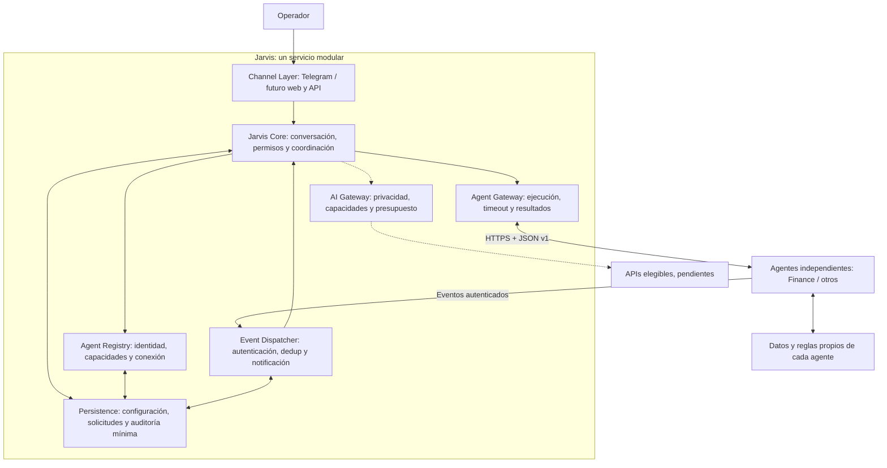

# Sir Jarvis — arquitectura del orquestador

**Decisión de Fase 1A.5, 2026-11-02:** Jarvis es un único servicio modular que
coordina aplicaciones independientes. Se abandona el diseño de dominio financiero
interno; sus requisitos están preservados en [Finance Agent](agents/FINANCE_AGENT_SPEC.md)
y su [matriz](agents/FINANCE_AGENT_TRACEABILITY.md). No se crea ningún otro servicio
o repositorio en esta fase.

## Estado verificable

| Componente                                  | Estado                                                                |
| ------------------------------------------- | --------------------------------------------------------------------- |
| Bootstrap, configuración y diagnóstico      | Implementados y probados                                              |
| Channel Layer: Telegram texto               | Implementada; aceptación real reportada por el operador el 2026-11-02 |
| Core: respuestas /start, /status y fallback | Implementado, determinista y sin enrutamiento externo                 |
| Agent Registry / Agent Gateway              | Diseño e interfaces TypeScript; sin implementación                    |
| Event Dispatcher                            | Diseño; sin endpoint externo ni inbox durable                         |
| AI Gateway                                  | Diseñado; proveedores deshabilitados                                  |
| Persistence Layer                           | Diseñada; sin nueva DB                                                |
| Agentes externos                            | Ninguno conectado ni implementado aquí                                |

El comportamiento y las respuestas actuales de Telegram se conservan, incluso
su texto de Fase 1A. El diagnóstico sigue describiendo el último corte funcional
y no afirma que el orquestador ya pueda invocar agentes.

## Diagrama objetivo

El diagrama representa el destino arquitectónico; la tabla de estado distingue
los componentes que ya existen. Los agentes pueden compartir un host por costo,
pero no pasan a ser módulos internos de Jarvis ni dependen de su ciclo de vida.

## Responsabilidades y límites

**Channel Layer.** Telegram recibe, autentica el origen por IDs/chat privado,
traduce entradas y presenta respuestas. Futuras web/API usan adaptadores propios.
No contiene reglas de agentes, SQL de dominio ni políticas específicas de proveedor.

**Jarvis Core.** Identifica la intención y contexto, pide aclaración/confirmación,
comprueba permisos y políticas antes de solicitar una capacidad y coordina estados.
Los datos externos nunca se convierten por sí solos en instrucciones o privilegios.
La IA podrá ayudar a interpretar; no es fuente de verdad ni autoridad para ejecutar.

**Agent Registry.** Catálogo administrado por el operador con IDs únicos por
instancia, versiones, capacidades/schemas, conexión permitida, referencias de
credenciales y disponibilidad observada. Un manifiesto remoto informa; no registra
ni habilita automáticamente. Permisos y consentimiento son locales. El estado
`unknown` no equivale a agente sano ni autoriza una llamada.

**Agent Gateway.** Resuelve únicamente conexiones registradas. Serializa contratos,
aplica credenciales en el transporte, valida entradas/salidas, conserva correlación,
idempotencia y deadlines, y normaliza errores. No evalúa amortizaciones, vuelos,
resultados deportivos ni otras reglas de negocio. Reintentar requiere seguridad
del efecto, autorización y presupuesto; una entrega incierta se concilia.

**Event Dispatcher.** Recibe eventos autenticados, valida replay, origen, contexto
y consentimiento, deduplica y registra entregas antes de distribuirlas. Los
destinatarios se resuelven localmente; un agente no elige chats ni herramientas.
Se necesita persistencia durable antes de abrir callbacks de producción. Las
tareas autónomas y su scheduler pertenecen a cada agente, no al Dispatcher.

**AI Gateway.** Futuro adaptador de APIs intercambiables. Filtra primero privacidad,
permisos, capacidad y presupuesto, después calidad/costo entre rutas elegibles.
Fallback solo entre rutas autorizadas. Sin ruta segura o presupuesto, falla cerrado.
Sin modelos locales iniciales, entrenamiento privado ni proveedores activos ahora.

**Persistence Layer.** Configuración, registro, consentimientos, referencias y
estados de solicitudes/operaciones, hashes y IDs de idempotencia/eventos, preferencias
y auditoría mínima. No guarda libros de movimientos, saldos, comprobantes ni las
bases internas de agentes. El payload mínimo para una entrega pendiente requiere
retención explícita y borrado; no se archiva toda la conversación.

## Dos flujos y fronteras de confianza

**Solicitud:** canal autorizado → Core (sujeto/capacidad/confirmación/política) →
Registry → Gateway → agente independiente. El agente vuelve a comprobar su
autorización y sus invariantes. Una respuesta válida debe coincidir con la solicitud;
Jarvis presenta su resultado sin reinterpretar contabilidad ni copiar su DB.

**Evento autónomo:** tarea del agente habilitada por su operador → evento firmado →
Dispatcher → inbox/outbox y autorización local → canal aprobado. La firma
autentica; no concede consentimiento para notificar. Un evento no puede crear
agentes, renovar permisos o activar consumo. Una finalización asíncrona se vincula
a la solicitud pendiente y solo admite una transición terminal válida.

En ambos flujos rigen [PRODUCT_RULES](PRODUCT_RULES.md) ORC-02…ORC-09 y
[AGENT_PROTOCOL](AGENT_PROTOCOL.md). Las preferencias financieras previas siguen
en el proyecto Finance Agent, sin ampliarse por conectarlo.

## Preparación técnica mínima

Se conserva `src/app/`, `src/channels/` e `infrastructure/`. La única adición
técnica de Fase 1A.5 es [src/agents/protocol.ts](../src/agents/protocol.ts):
tipos de manifiestos, configuración local, solicitudes/resultados/eventos y puertos
Registry/Gateway, sin importarlos al bot. No validan JSON no confiable.

Fase 1B podrá añadir implementaciones pequeñas de Registry en memoria y Gateway
con transporte falso detrás de esos puertos, sin red ni servicios de dominio.
Una interfaz no exige un directorio por componente; crear archivos cuando tengan
uso verificable. No introducir nuevos paquetes, base de datos, ORM, scheduler,
servidor webhook, cola o microservicios internos por anticipación.

La primera conexión real del Gateway esperará Fase 1C y un agente ficticio
independiente autorizado. Una eventual librería compartida o schema publicable
se evaluará después de probar compatibilidad entre lenguajes; el protocolo no
obliga a importar el código de Jarvis.

## Persistencia, auditoría y fallos futuros

Elegir almacenamiento por consumo y consistencia requeridos antes de Fase 3.
Puede evaluarse SQLite para una instancia o PostgreSQL si se justifican concurrencia
y operación; no se añade ninguno ahora. Las bases y migraciones internas de cada
agente son su responsabilidad, incluso si se alojan en el mismo proveedor.

Distinguir aceptación, pendiente, completada, fallida e incierta. Registrar actor
opaco, agente, IDs, estado y timestamps sin secretos ni contenido innecesario.
La deduplicación en memoria de Telegram no garantiza idempotencia de acciones
externas. Un crash entre envío y confirmación puede dejar entrega incierta; no
prometer exactamente una vez ni reintentar una operación sensible a ciegas.
Las claves de negocio y transacciones se implementan en el agente de dominio.

## Despliegue y extensión

Objetivo inicial: Ubuntu en un Droplet y Docker Compose, bajo autorización futura.
Plan y límites en [DEPLOYMENT_STRATEGY](DEPLOYMENT_STRATEGY.md). No hay Dockerfile,
Compose operativo ni recursos contratados en esta fase. Jarvis seguirá siendo un
proceso modular; aplicaciones externas pueden desplegarse juntas o por separado.
HTTPS/JSON será el primer transporte y MCP un adaptador posterior con los mismos
permisos. Una cola distribuida solo se considerará ante métricas de volumen,
backpressure o varias réplicas que superen una inbox/outbox transaccional.
