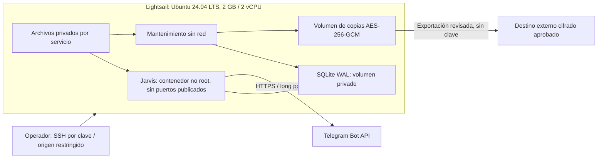

# Runbook del piloto controlado en AWS Lightsail

Fase 1F prepara este procedimiento; **no ejecuta un despliegue**, consulta Billing
o crea recursos. El operador debe autorizar por separado la región, el recurso,
el costo bruto/neto, el destino externo de copias y las acciones administrativas
del [checklist](AWS_PILOT_CHECKLIST.md). Las pruebas locales se registran en
[PHASE_1F_VALIDATION](PHASE_1F_VALIDATION.md), sin atribuirles aceptación en AWS.

## Arquitectura y primer corte

Propuesta: una instancia Lightsail Linux de **2 GB RAM y 2 vCPU**, Ubuntu
**24.04 LTS**, Docker Engine y Compose. Se elige esa versión por compatibilidad
revisada; no se afirma que sea la LTS más reciente. Jarvis conserva un único
proceso modular, SQLite WAL local y Telegram por long polling. El piloto inicial
usa los comandos actuales de diagnóstico, con **integración de agentes apagada**.
No se despliega Echo ni agentes de negocio; una futura conexión HTTPS requiere
otra autorización y configuración de origen, capacidad y credenciales.



No hay balanceador, DB administrada, servidor público del Gateway, webhook,
scheduler o puerto HTTP de ingreso. La propuesta sigue siendo portable a otra
VPS. Un host único implica una falla común de cómputo y disco; los volúmenes
Docker no son copias externas ni alta disponibilidad.

## Autorización y expediente privado

Antes de ejecutar los pasos de host, completar el [checklist](AWS_PILOT_CHECKLIST.md)
y archivar privadamente: región/bundle cotizados, fecha de revisión de créditos,
presupuesto, responsable, ventana de mantenimiento, IP/CIDR administrativo,
versiones de paquetes, SHA de código, ID de imagen, custodia de claves, evidencia
de restore y procedimiento de salida. No adjuntar tokens, credenciales, correos,
IPs personales o identificadores de cuenta al PR público.

El presupuesto de referencia es **USD 25 mensuales brutos**; el costo, los créditos
realmente aplicables y el gasto neto se calculan por separado. Consultar la
[estimación fechada y la estrategia externa de backup](AWS_DEPLOYMENT_PLAN.md).
Los USD 200 nominales reportados no autorizan gasto ni prueban saldo vigente.

## Preparar Ubuntu después de la autorización

Estos pasos se ejecutarían en una VPS autorizada; no se ejecutan como parte de
Fase 1F. Registrar los resultados y detener el procedimiento si falla un control.

1. Verificar la huella SSH por un canal independiente. Crear un administrador
   individual con `sudo`, instalar su clave pública y probar una segunda sesión
   antes de tocar el acceso existente. No copiar claves privadas al servidor.
2. Preparar un archivo de configuración SSH revisado bajo
   `/etc/ssh/sshd_config.d/` que exija claves, niegue login root y deshabilite
   autenticación por contraseña/teclado para el usuario aprobado. Comprobar la
   configuración efectiva, incluidas reglas `Match`, con `sudo sshd -T`; ejecutar
   `sudo sshd -t` antes de `sudo systemctl reload ssh`. Conservar abierta la
   primera sesión hasta verificar el acceso nuevo y una ruta de recuperación.
   [Guía oficial OpenSSH de Ubuntu](https://ubuntu.com/server/docs/how-to/security/openssh-server/).
3. Actualizar el sistema y registrar los paquetes efectivos:

   ```sh
   sudo apt-get update
   sudo apt-get upgrade
   lsb_release -ds
   uname -r
   timedatectl status
   df -h /
   free -m
   ```

   Revisar actualizaciones de seguridad y planificar reinicios en una ventana
   controlada; no permitir que una actualización invalide la recuperación sin
   ensayo previo. [Actualizaciones automáticas de Ubuntu](https://ubuntu.com/server/docs/how-to/software/automatic-updates/).

4. En el firewall Lightsail permitir exclusivamente SSH desde el CIDR
   administrativo autorizado; retirar reglas HTTP/HTTPS y SSH global que no
   correspondan. Revisar IPv4 e IPv6 por separado y el acceso por red privada.
   El firewall del proveedor no filtra el egreso ni toda la red privada.
   [Semántica de firewalls Lightsail](https://docs.aws.amazon.com/lightsail/latest/userguide/understanding-firewall-and-port-mappings-in-amazon-lightsail.html).
5. Añadir primero la regla SSH equivalente en el firewall local, después la
   política de ingreso denegado y comprobarla desde otra sesión. No ejecutar
   `ufw reset`, reemplazar todo el ruleset o cerrar la sesión existente para
   probar acceso. Registrar `sudo ufw status verbose`, sockets en escucha y
   reglas IPv6. [Firewall de Ubuntu](https://ubuntu.com/server/docs/how-to/security/firewalls/).

Instalar Docker desde su repositorio APT oficial con firma, usando las
[instrucciones para Ubuntu](https://docs.docker.com/engine/install/ubuntu/).
Inventariar paquetes en conflicto antes de removerlos; no usar el script de
conveniencia ni una purga indiscriminada. Elegir versiones publicadas concretas
de Engine, CLI, containerd, Buildx y Compose, archivarlas en el expediente y
repetir las pruebas después de cualquier actualización. Comprobar:

```sh
docker version
docker compose version
systemctl is-enabled docker
systemctl is-active docker
```

Los scripts operativos del repositorio también requieren Node **24.22.1+ de la
rama 24** en la máquina administrativa que los ejecuta. Si se ejecutan en la
VPS, instalar esa versión de forma revisada, verificando los checksums/firmas
publicados en la [distribución oficial de Node](https://nodejs.org/dist/), y
registrar `node --version`. Instalar Docker no instala automáticamente ese CLI.
No ejecutar instaladores remotos canalizados a una shell. No se necesita instalar
dependencias npm en la VPS para los scripts `.mjs` operativos.

Dar acceso al socket Docker únicamente al administrador autorizado; pertenecer
al grupo `docker` concede privilegios equivalentes a root. No montar ese socket
en Jarvis, mantenimiento o agentes ni usar un usuario de aplicación como
administrador del daemon. [Modelo de permisos Docker](https://docs.docker.com/engine/install/linux-postinstall/).

## Egreso y firewall antes de iniciar el bot

No confundir `ports: []`, UFW o la allowlist de agentes con un firewall completo
de salida. Docker gestiona reglas de encaminamiento y los puertos publicados
pueden evitar controles UFW; en este piloto no se publica ninguno. Se debe
comprobar el backend efectivo del host y configurar una política específica de
egreso del bridge antes del arranque autorizado. Para el backend iptables,
Docker documenta `DOCKER-USER` para reglas anteriores a las de sus contenedores.
No desactivar la gestión de reglas de Docker ni mezclar un backend distinto sin
validación. [Firewall Docker](https://docs.docker.com/engine/network/packet-filtering-firewalls/),
[reglas con iptables](https://docs.docker.com/engine/network/firewall-iptables/).

Procedimiento que debe aprobarse y ensayarse en Ubuntu:

1. El Compose piloto reserva `172.30.78.0/28` y la IP de Jarvis `172.30.78.2`,
   con IPv6 deshabilitado en esa red. Crear los contenedores sin iniciarlos,
   inspeccionar exclusivamente la red/IP y comprobar que no colisionan con redes existentes. No
   aplicar reglas a todas las redes Docker o a la interfaz administrativa.
2. Registrar el resolver DNS aprobado y los destinos IPv4/IPv6 requeridos por
   `api.telegram.org`. Las direcciones pueden cambiar: resolver, revisar y
   actualizar un conjunto de direcciones administrado; no fijar una IP histórica
   como si fuese permanente ni permitir Internet completo por un fallo DNS.
3. Para el tráfico reenviado del bridge de Jarvis, permitir respuestas de
   conexiones establecidas, DNS solo al resolver aprobado y TCP 443 solo a los
   destinos Telegram revisados; denegar el resto. Resolver el tratamiento del
   DNS embebido de Docker y su reenvío desde el host con una prueba real, porque
   no todo ese tráfico pasa por la misma cadena. NTP es una necesidad del host,
   no una autorización general del contenedor. Denegar una ruta IPv6 alternativa
   si no está expresamente configurada. Mantener mantenimiento en `network_mode: none`.
4. Reaplicar y comprobar la política al recrear la red, reiniciar Docker o el
   host, antes de reabrir el bot. No asumir persistencia por haber guardado un
   listado de reglas. El orden de arranque y la persistencia del firewall son
   pendientes de validación en la VPS; un reboot sin ellos no está aprobado.
5. Probar sin tokens: acceso HTTPS al destino aprobado, fallo hacia un destino
   no autorizado, rechazo de metadata/link-local y ausencia de ingress público.
   Archivar contadores de reglas y resultados, sin cuerpos o URLs con secretos.

La configuración Compose por sí sola no implementa esta allowlist de egreso.
Fase 1F no instala reglas en el host del operador ni afirma haberlas probado en
Ubuntu/AWS. **No iniciar el piloto real hasta validar ese control**. Una futura
conexión de agentes añade solo orígenes/IP autorizados individualmente, TLS válido
y permisos locales; no elimina la política SSRF ni permite loopback/metadata.

## Release e imagen concretos

Después de fusionar Fase 1F, el operador debe seleccionar un SHA completo
revisado y aceptado por CI que incluya este runbook y `deploy/compose.pilot.yaml`.
`fcbe50f2c59f3f1266a02f4b4ec609924d90af9d` identifica el merge previo de Fase
1E.2, **no** la futura versión desplegable de Fase 1F. No usar `main` móvil como
identificador de release ni inventar un SHA de aprobación.

En una máquina de build confiable, preparar un checkout separado sin archivos
privados. Definir `JARVIS_RELEASE_SHA` con el SHA aprobado y validar su formato:

```sh
set -eu
test "${#JARVIS_RELEASE_SHA}" -eq 40
case "$JARVIS_RELEASE_SHA" in *[!0-9a-f]*) exit 1;; esac
git fetch origin
git worktree add --detach ../jarvis-pilot-release "$JARVIS_RELEASE_SHA"
cd ../jarvis-pilot-release
test "$(git rev-parse HEAD)" = "$JARVIS_RELEASE_SHA"
test -z "$(git status --porcelain)"
docker build --pull --tag "sir-jarvis:pilot-$JARVIS_RELEASE_SHA" .
export JARVIS_PILOT_IMAGE="$(docker image inspect --format '{{.Id}}' "sir-jarvis:pilot-$JARVIS_RELEASE_SHA")"
docker image inspect --format '{{.Id}} {{.Os}}/{{.Architecture}} {{.Config.User}}' "$JARVIS_PILOT_IMAGE"
```

El bloque parte de un clon conocido del repositorio público obtenido por HTTPS.
Para una máquina sin checkout, obtenerlo con
`git clone https://github.com/ingmiguelangelgosan/sir-jarvis.git` en un directorio
nuevo y entrar en él antes del bloque. Comprobar el remoto esperado; no insertar
un token en la URL. La aprobación del SHA proviene del PR/CI revisado, no solo
de que un servidor Git permita descargarlo.

La imagen Node base está fijada por versión y digest en el Dockerfile; verificar
que sigue aprobada antes del build. `npm ci` conserva el lockfile, pero un build
correcto no demuestra reproducibilidad binaria entre arquitecturas. Registrar
SHA de fuente, ID de imagen, arquitectura, fechas, resultado de pruebas y base.
En el ensayo local las capas rootfs del segundo build con caché coincidieron,
pero el ID OCI cambió al regenerarse atestaciones de provenance. No desactivarlas
para aparentar reproducibilidad; registrar el artefacto realmente cargado y no
exigir que cualquier rebuild independiente produzca el mismo ID.
Si el build local usa una arquitectura distinta de la VPS, construir y probar
la correcta; no asumir que un archivo de imagen es multi-arquitectura.

Distribuir la imagen mediante un archivo OCI/Docker o registro ya aprobado. Para
transferencia por archivo, hacer `docker image save` de la etiqueta revisada a
un archivo nuevo, generar SHA256, enviarlo por SSH y verificarlo mediante un
canal de confianza antes de `docker image load`. Confirmar que el ID cargado es
el esperado. Si se elige un registro, descargar una referencia
`repositorio@sha256:...` aprobada y verificar su digest antes de resolver el ID
local requerido por el Compose. Cotizar acceso/egreso; no crear un registro pago
en esta fase. El
host necesita también el checkout de release para Compose y los scripts; no
transportar `.env`, carpetas `.local/`, fixtures privados o credenciales.

`JARVIS_PILOT_IMAGE` exige un ID local exacto `sha256:<64 hex>`, no una etiqueta
móvil o el digest del manifiesto de un repositorio. Son identificadores distintos:
registrar por separado Git SHA, digest base/multiarquitectura, digest de distribución
si corresponde e ID local. `pull_policy: never` evita descargar otra imagen como
efecto lateral de iniciar el servicio.

Los ejemplos posteriores suponen un administrador autorizado para Docker. Si
usa `sudo`, pasar únicamente estas variables no secretas explícitamente, sin
conservar todo su entorno. No dar acceso general al socket para evitar `sudo`.

## Configuración privada y almacenamiento

El archivo [compose.pilot.yaml](../deploy/compose.pilot.yaml) es independiente del
Compose de demostración. No necesita certificados Echo, HMAC de acciones o
Bearer de agentes porque la integración está apagada. Preparar fuera del repo
un directorio privado, por ejemplo `/srv/jarvis-pilot/private`, con:

| Archivo          | Consumidor    | Contenido                                                           |
| ---------------- | ------------- | ------------------------------------------------------------------- |
| `telegram-token` | Jarvis        | Token real del bot aprobado, sin incluirlo en comandos o logs       |
| `allowed-users`  | Jarvis        | IDs permitidos, separados por comas; chat privado sigue obligatorio |
| `backup.key`     | Mantenimiento | 32 bytes aleatorios en base64url canónico, custodia separada        |

Crear los archivos exclusivamente, con directorios 0700 y archivos 0600 legibles
por UID/GID `1000:1000`; revisar propietarios antes de cambiar permisos. No
reutilizar tokens/HMAC como clave de backup ni imprimir los valores. En Windows,
la preparación local requiere ACL privadas; no tomar `chmod` como prueba de ACL.
Compose monta los secretos, pero no cifra los archivos del host. Mantener una
copia segura de recuperación de credenciales y claves fuera de la VPS.

```sh
export JARVIS_PILOT_PRIVATE_DIR=/srv/jarvis-pilot/private
docker compose -p sir-jarvis-pilot -f deploy/compose.pilot.yaml config --quiet
node deploy/pilot-preflight.mjs sir-jarvis-pilot
docker compose -p sir-jarvis-pilot -f deploy/compose.pilot.yaml create jarvis
```

No imprimir la configuración completa o `docker inspect` completo: pueden mostrar
configuración privada. Revisar únicamente campos necesarios de imagen, usuario,
montajes, redes, puertos y límites. Confirmar usuario 1000, rootfs de solo lectura,
capabilities eliminadas, `no-new-privileges`, ausencia de `privileged`, socket y
puertos. Los volúmenes de estado, backups y recuperación son distintos y locales;
no usar NFS. Reservar capacidad para SO, Docker, WAL, imágenes y mantenimiento.

Para una instalación **realmente nueva**:

```sh
docker compose -p sir-jarvis-pilot -f deploy/compose.pilot.yaml run --rm --entrypoint node maintenance dist/app/state-main.js init /data/state/jarvis.sqlite
docker compose -p sir-jarvis-pilot -f deploy/compose.pilot.yaml run --rm maintenance inspect /data/state/jarvis.sqlite
```

El inicializador rechaza archivos existentes. Un archivo perdido o corrupto exige
recuperación, nunca `init` para crear historia vacía. Se distribuye la migración
001 junto al build y solo se admite esquema 1. No hay migración automática de
historia incompatible: detener, conservar original y probar una migración
versionada en aislamiento en otro incremento antes de autorizarla.

## Inicio y aceptación limitada

Confirmar primero: release/imágenes aprobados, firewall y egreso comprobados,
estado válido, secretos propios, autorización de costos y un solo consumidor del
token en todos los equipos. Los locks locales no coordinan dos hosts.

```sh
node deploy/pilot-preflight.mjs sir-jarvis-pilot
docker compose -p sir-jarvis-pilot -f deploy/compose.pilot.yaml up -d --no-build jarvis
docker compose -p sir-jarvis-pilot -f deploy/compose.pilot.yaml ps
docker compose -p sir-jarvis-pilot -f deploy/compose.pilot.yaml exec -T jarvis node /app/healthcheck.mjs
node deploy/pilot-inspect.mjs sir-jarvis-pilot
```

Desde el chat privado del operador, probar `/start`, `/status`, texto no
implementado y comando desconocido. Probar un usuario no permitido y un grupo:
no deben ejecutar operaciones. Los comandos de agentes conservan el fallback al
estar deshabilitados. No activar Echo para demostrar una conexión de producción
inexistente. No repetir una solicitud incierta para inferir su estado.

El health check confirma heartbeat/proceso local, no conectividad reciente con
Telegram o agentes. Registrar por separado recepción/respuesta manual, backoff,
429 y errores seguros; no archivar conversación ni token como evidencia. Detener
si hay reinicios repetidos, fallos de autorización, permisos o límites de disco.

La política `on-failure:3` limita reintentos del contenedor ante error; no garantiza
arranque cuando reinicia el daemon. Después de reiniciar la VPS/Docker, este
piloto exige arranque manual tras comprobar firewall, estado y preflight. No
combinar otro supervisor automático con esa política sin rediseñar y probar su
orden de arranque. [Políticas de reinicio Docker](https://docs.docker.com/engine/containers/start-containers-automatically/).

Con agentes apagados, el bot abre la DB y comprueba el gate de recuperación,
pero no conecta el journal de acciones ni recupera un offset Telegram durable.
La deduplicación de `/start`, `/status` y fallback es de memoria: después de un
reinicio pueden repetirse respuestas diagnósticas. No se habilitan efectos de
negocio ni se presenta este piloto como entrega conversacional exactamente una
vez. El campo de revisión `telegram_next_offset` sigue exigido por el CLI de
recuperación, pero su floor solo se carga en el flujo con journal de agentes.

## Operación, copias externas y métricas

Inspección sin valores secretos:

```sh
node deploy/pilot-inspect.mjs sir-jarvis-pilot
df -h /
free -m
docker compose -p sir-jarvis-pilot -f deploy/compose.pilot.yaml run --rm maintenance inspect /data/state/jarvis.sqlite
docker compose -p sir-jarvis-pilot -f deploy/compose.pilot.yaml run --rm maintenance backup /data/state/jarvis.sqlite /backups /run/secrets/backup_key
docker compose -p sir-jarvis-pilot -f deploy/compose.pilot.yaml run --rm maintenance verify /backups/<archivo-devuelto>.jvb /run/secrets/backup_key
```

El inspector agrega CPU/RAM, salud local, reinicios, espacio y tamaños SQLite/WAL,
conteos de fases y eventos seguros recientes cuando estén disponibles. No
presentar ausencia de instrumentación de latencia/timeout del Gateway como cero
errores. El piloto inicial no ejecuta el Gateway al tener agentes apagados.
Gasto, crédito y conectividad real se revisan por procedimientos separados,
previa autorización del acceso AWS; no son métricas que el contenedor conozca.

Seguir la estrategia de [backup externo](AWS_DEPLOYMENT_PLAN.md) y
[BACKUP_RESTORE](BACKUP_RESTORE.md): exportar solo `.jvb` verificado, conservar
nombre UUID, hash y metadatos, transferir sin clave al destino privado autorizado
y comprobar descarga/restauración desde otra máquina. No usar `sync --delete`
ni sobrescribir una clave de objeto existente. El uploader, si se autoriza,
vive fuera del Core con identidad y permisos separados del bot. Crear el backup
y dejarlo en otro volumen de la misma VPS no cubre pérdida del servidor.

La retención inicial propuesta es siete diarias y cuatro semanales; debe
aprobarse y verificarse contra costos, versionado e inmutabilidad. No hay
scheduler de backup desplegado por Fase 1F. Hasta aprobarlo, el operador ejecuta
y registra las copias en ventanas acordadas. Sin una copia externa verificada,
el piloto no cumple el requisito de recuperación ante pérdida de VPS. Los
snapshots del proveedor son complemento, no sustituto de SQLite/conciliación.

## Recuperación y actualización

| Incidente                        | Acción del operador antes de reanudar                                                                                                                                                                                                             |
| -------------------------------- | ------------------------------------------------------------------------------------------------------------------------------------------------------------------------------------------------------------------------------------------------- |
| Jarvis cae / pierde conectividad | Inspeccionar salud, códigos seguros, disco y permisos. Resolver causa; un timeout no prueba ausencia de efecto. No eliminar reservas ni ampliar destinos.                                                                                         |
| Reinicio de instancia            | Verificar volumen, exclusión del consumidor, imagen, firewall/egreso y arranque controlado. Probar salud local y Telegram autorizado; no confiar en el restart por sí solo.                                                                       |
| Pérdida de volumen o corrupción  | Detener el bot; preservar originales/sidecars existentes. Recuperar la última copia externa verificable hacia destino nuevo, sin crear DB vacía.                                                                                                  |
| Credencial perdida o expuesta    | Parar el consumidor, revocar/rotar mediante el servicio responsable y distribuir el secreto nuevo por canal seguro. No incluirlo en tickets o archivos versionados. Si se pierde la clave de cifrado sin escrow, el backup no se puede recuperar. |
| Pending/uncertain                | Inspeccionar referencias opacas y conciliar con registros independientes; no hacer replay, resetear claves o convertir incertidumbre en fallo confirmado.                                                                                         |
| Release defectuoso               | Detener el contenedor, conservar estado y evidencia; comprobar compatibilidad de esquema/semántica con la imagen anterior antes de revertir solo código.                                                                                          |

Procedimiento para recuperar un backup externo:

1. Detener el bot original y todo consumidor del mismo token en otros hosts.
   Descargar la copia cifrada a almacenamiento privado; verificar hash contra
   evidencia externa y autenticación mediante `maintenance verify`.
2. Ejecutar `maintenance restore <backup> /recovery/<destino-nuevo> <key-file>`.
   La salida crea `state.sqlite` con un nuevo ID y gate **blocked**. Mantener
   originales y backups intactos. Nunca copiar solo el principal de SQLite con
   WAL activo, reemplazar la DB viva o reutilizar un directorio de restore.
3. Inspeccionar fases/referencias, integridad, versión y permisos. Una copia
   antigua puede omitir acciones ya ejecutadas; comparar el intervalo con una
   fuente externa. Si la revisión está truncada o no se puede determinar el
   intervalo, mantener el bloqueo. Registrar explícitamente lo desconocido.
4. Preparar el review privado del formato documentado en
   [BACKUP_RESTORE](BACKUP_RESTORE.md), con el ID concreto, evidencia SHA256 y
   próximo offset Telegram justificado. En este piloto sin journal, revisar y
   aceptar explícitamente las posibles respuestas diagnósticas antiguas o
   descartarlas mediante una operación administrativa autorizada y verificada
   antes de reiniciar; no ejecutar `getUpdates` como si fuera una inspección
   pasiva, pues el offset puede confirmar entregas. El valor guardado por el CLI
   no filtra por sí solo estos mensajes al tener agentes apagados.
   Ejecutar `maintenance authorize` con
   `--acknowledge-backup-rollback` solo tras autorización del operador. Esta
   decisión no borra reservas ni demuestra ejecución exactamente una vez.
5. Configurar un override privado del Compose piloto que monte el volumen de
   recuperación y fije `JARVIS_STATE_FILE` al archivo revisado. Conservar el
   directorio runtime compartido original para impedir otro consumidor local.
   Validar el resultado de Compose, red/egreso e imagen antes de iniciar. No
   aplicar sin revisión el overlay del demo local a este archivo independiente.
   El preflight inicial verifica solo el manifiesto base y la ruta
   `/data/state/jarvis.sqlite`; no lee el override de recuperación y su PASS
   no valida esa restauración. El expediente de
   recuperación debe verificar de forma explícita el destino revisado y todos
   los demás controles; el inspector inicial también mide esa ruta original.
   Para el archivo restaurado usar `maintenance inspect` con su ruta concreta.
   El soporte de preflight/inspección automático para destinos recuperados es un
   incremento pendiente; mantener el gate si falta la revisión completa.
6. Repetir salud, autorización, entrega Telegram y backup externo del estado
   recuperado; medir RTO completo incluyendo revisión humana. No trasladar los
   milisegundos del ensayo sintético al tiempo de recuperación de AWS.

Para actualizar, congelar efectos, crear y verificar un backup externo, registrar
imagen anterior y nueva, comprobar compatibilidad de esquema, detener y recrear
**un solo** Jarvis con el nuevo ID inmutable. Repetir aceptación limitada y
guardar una salida de inspección saneada. Volver a la imagen anterior no exige
restaurar una DB antigua: ese rollback de datos activa el mismo procedimiento de
gate y conciliación. No hacer downgrade del esquema a ciegas ni rotar HMAC o
bindings para saltar una incompatibilidad.

## Detención y salida

```sh
docker compose -p sir-jarvis-pilot -f deploy/compose.pilot.yaml stop -t 40 jarvis
docker compose -p sir-jarvis-pilot -f deploy/compose.pilot.yaml ps -a
```

Confirmar cierre ordenado y ausencia de otro poller. No usar `down -v`, borrar
volúmenes o `docker system prune` en el procedimiento normal. Antes de salir del
proveedor, exportar y restaurar en otro host aprobado, mover un solo consumidor,
conservar claves y conciliar. Detener Lightsail no elimina su costo: la eventual
eliminación del recurso y de snapshots/discos/IP requiere inventario y permiso
separados, después de validar la recuperación. Ver
[costos y procedimiento de salida](AWS_DEPLOYMENT_PLAN.md).

## Evidencia pendiente y siguiente autorización

La aceptación AWS exige mediciones en la instancia real: instalación/versiones,
SSH/recuperación, reglas IPv4/IPv6, egreso denegado por defecto, persistencia de
reglas tras reboot, token real, copia externa, restore en host de reemplazo,
RPO/RTO con revisión humana y consumo sostenido. Ninguno se marca como probado
por funcionar Docker Desktop o una API Telegram simulada. Confirmar crédito y
costo sin publicar datos de Billing. Si falta un control, detener el arranque.

El siguiente prompt debe autorizar recursos y acciones concretas después de
revisar este runbook y el checklist, manteniendo lectura, IA apagada y sin agentes
de dominio. Aplican [PRODUCT_RULES](PRODUCT_RULES.md)
ORC-01/02/03/04/05/06/07/08/11/12.
