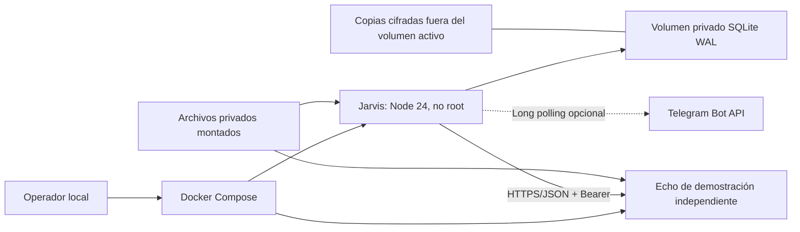

# Ejecución local con Docker Compose

Fase 1E.2 prepara una instalación local reproducible, sin desplegar recursos AWS.
Jarvis sigue siendo un monolito modular; Echo es un proceso independiente de
demostración. Finance Agent y los futuros agentes de vuelos o deportes no forman
parte de esta instalación. IA permanece apagada y las capacidades admitidas son
de lectura con `cost_policy: no-paid-services`.

La evidencia efectiva de build, Compose y recuperación se registra en
[PHASE_1E2_VALIDATION](PHASE_1E2_VALIDATION.md). No atribuir a una prueba local
capacidad suficiente para Lightsail de 2 GB o recuperación de un fallo de AWS.

## Preparación del host

Usar Docker Engine con Compose v2 en Linux, o Docker Desktop con contenedores
Linux y backend WSL2 en Windows. Mantener el proyecto y los datos SQLite en un
filesystem local; desde WSL2, preferir el filesystem Linux para modos y semántica
de archivos. Verificar que el motor esté activo antes de atribuir un error al
proyecto:

```sh
docker version
docker compose version
```

Los comandos de npm se ejecutan con Node 24.22.1+ de la rama 24. En PowerShell se
puede usar `npm.cmd` cuando la política de ejecución no permite `npm.ps1`. Las
pruebas habituales de Node y la CI Windows/Linux no necesitan Docker, Telegram
real o credenciales AWS.

## Fronteras de contenedores y red



No se publican puertos del bot o de SQLite. Echo no es una dependencia obligatoria
de producción. La red privada de Compose no amplía permisos: el agente necesita
origen permitido, IP privada exacta registrada, nombre TLS válido y CA aprobada.
Se mantiene la validación DNS/IP por conexión y se rechazan loopback, link-local,
metadata, redirects y excepciones generales de TLS/SSRF.

La red `agents_private` es interna y usa `172.30.77.0/24`; solo
`172.30.77.10` se autoriza para `https://echo:8443`. Echo presenta un certificado
para el nombre `echo`. Jarvis tiene además `telegram_egress` para long polling;
no es un firewall completo de salida. Si esa subred colisiona con la red del
host, elegir otra RFC1918 y cambiar de forma coherente IPAM, IP fija y la IP exacta
del origen en la configuración privada. Repetir la prueba HTTPS con la política
productiva, sin permitir un rango completo ni desactivar DNS/TLS.

| Perfil     | Servicio         | Uso                                               |
| ---------- | ---------------- | ------------------------------------------------- |
| `telegram` | `jarvis`         | Bot real por long polling; requiere token propio  |
| `demo`     | `echo`           | Agente ficticio independiente, optativo           |
| `test`     | `smoke` y `echo` | Telegram simulado y HTTPS real entre contenedores |
| `tools`    | `maintenance`    | Inspección y backup/restore sin red               |

El perfil adicional `recovery-test` se usa únicamente por el probe de fallos:
monta una API Telegram simulada en el entrypoint normal y herramientas de
mantenimiento del volumen de prueba. No debe usarse para el bot real.

## Imágenes y permisos

El Dockerfile usa build multietapa, `npm ci` desde el lockfile y compilación
TypeScript. La etapa final distribuye el código compilado, las migraciones y
dependencias de ejecución; no incluye herramientas de desarrollo, fixtures o
claves privadas de pruebas. El usuario final no es root y el código se separa de
los directorios de datos y runtime.

Compose aplica filesystem de solo lectura, `no-new-privileges`, capabilities
eliminadas y límites de CPU, memoria y procesos. Los únicos montajes de escritura
son los necesarios para estado y runtime temporal. No se monta el socket Docker.
Una limitación de recursos es un control local, no una garantía de capacidad o
de ausencia de OOM.

Las imágenes base fijan versión y digest. Para actualizarlas, revisar el release
oficial de Node 24 y su imagen oficial, comprobar el manifiesto y los digest de
arquitecturas requeridas, actualizar todas las bases coherentemente y repetir
tests, build, Compose y recuperación. No sustituir la referencia por `latest`
ni actualizar dependencias del lockfile como efecto lateral de cambiar la base.

La base inicial es
`node:24.22.1-bookworm-slim@sha256:be8204d4bd327363357f532187b752ff62759c31bedf98e9e18fc08c9cbd605c`,
manifiesto multi-arquitectura de la imagen oficial verificado el 2026-11-03.
Consultar la [imagen oficial Node](https://hub.docker.com/_/node) y
[buenas prácticas Docker](https://docs.docker.com/build/building/best-practices/#pin-base-image-versions).
El digest fija contenido, pero requiere mantenimiento para incorporar parches.

## Preparar material de demostración

`setup-local.mjs` crea un directorio nuevo exclusivamente; el padre debe existir.
No lee ni reemplaza secretos del operador. Desde PowerShell, con `.local` ya
preparado y privado:

```powershell
$localComposeDirectory = Join-Path (Get-Location).Path '.local/compose'
node deploy/setup-local.mjs $localComposeDirectory
$env:JARVIS_PRIVATE_DIR = $localComposeDirectory
```

En Linux/WSL2:

```sh
node deploy/setup-local.mjs "$PWD/.local/compose"
export JARVIS_PRIVATE_DIR="$PWD/.local/compose"
```

Genera `secrets/hmac.key`, `backup.key`, `echo-bearer`, `echo-server.key`,
`echo-server.crt`, `echo-ca.crt`, `agents.json` y `allowed-users`, además de
`backups/` y `recovery/`. La CA de prueba dura 30 días; no conserva su clave
privada. Es material local aislado y no una PKI de producción. No se crea
`telegram-token`: la demostración automática no lo necesita.

La identidad ficticia inicial es `42`. No habilitar un bot real con ese valor:
antes de vincular la DB, editar privadamente `allowed-users` y el binding de
`agents.json` con el ID permitido. Esos archivos son datos administrados, no
entradas de conversación. No cambiar el binding tras crear historia para
sortear una validación; requiere conciliación/migración.

Los servicios corren como UID/GID `1000:1000`. Los archivos 0600 y directorios
0700 montados deben ser accesibles a ese usuario. En Linux, preparar propietario
y permisos para esa instalación; no resolver un error ampliando a lectura global.
En Docker Desktop revisar cómo el backend aplica los montajes y las ACL del host.

## Construcción y prueba sin Telegram real

```sh
docker compose --profile test build
docker compose --profile test up --abort-on-container-exit --exit-code-from smoke smoke
docker compose --profile test run --rm smoke
docker compose --profile test stop
```

El primer recorrido usa Telegram simulado y Echo HTTPS real. La segunda ejecución
reabre el volumen `smoke_state` para probar deduplicación al reiniciar. No usa el
volumen operativo `jarvis_state`, un token real o AWS. Conservar el volumen de
prueba permite repetir una clave; para un ensayo limpio crear otro proyecto de
Compose deliberadamente, sin borrar datos del operador.

Para repetir además stop/start, señales, exclusión del segundo consumidor y
recuperación del estado entre contenedores:

```sh
node deploy/compose-check.mjs <directorio-absoluto-privado-de-prueba>
```

Este comando requiere el motor Docker activo; falla si Docker no está disponible.
Crea un proyecto con nombre único y volúmenes propios, usa solo credenciales
ficticias del setup y al terminar conserva los volúmenes para inspección. Su API
Telegram está simulada; la comunicación con Echo usa HTTPS real. Detener antes
otro demo que ocupe la subred estática. No reutiliza ni borra el almacenamiento
operativo del bot del operador.

## Iniciar el bot real de forma explícita

1. Crear privadamente `secrets/telegram-token` con el token del bot propio, sin
   imprimirlo ni versionarlo. Configurar allowlist y binding como se indicó.
2. Inicializar exclusivamente una DB nueva en el volumen operativo:

   ```sh
   docker compose --profile tools run --rm --entrypoint node maintenance dist/app/state-main.js init /data/state/jarvis.sqlite
   ```

   Un archivo existente se rechaza. Este comando no recupera una DB perdida.

3. Sin agentes, mantener la variable de integración en `false`, su valor por
   defecto, y ejecutar:

   ```sh
   docker compose --profile telegram up -d --build jarvis
   ```

4. Para probar el Echo independiente con `/agent demo.echo echo.reply Hola Jarvis`,
   habilitar expresamente `JARVIS_TELEGRAM_AGENTS_ENABLED=true` en el entorno del
   proceso Compose. En PowerShell:

   ```powershell
   $env:JARVIS_TELEGRAM_AGENTS_ENABLED = 'true'
   docker compose --profile telegram --profile demo up -d --build echo jarvis
   ```

   En Linux/WSL2 usar `export JARVIS_TELEGRAM_AGENTS_ENABLED=true` antes del mismo
   comando. El registro local tiene únicamente Echo de lectura habilitado. No
   iniciar otro consumidor con ese token fuera de Compose.

`/start`, `/status`, allowlist, chat privado y fallback se conservan. `/agents`
solo muestra capacidades autorizadas. Con la integración apagada, los comandos de
agentes mantienen el comportamiento previo. La guía de
[Telegram](TELEGRAM.md) explica BotFather y la aceptación manual.

## Secretos y configuración privada

Usar archivos privados montados para token Telegram, allowlist, clave HMAC,
Bearer del agente y material TLS. La configuración de agentes se administra
localmente; un mensaje de Telegram no registra agentes ni modifica permisos.
Mantener separados la clave HMAC estable, la autenticación del agente y la clave
de backup. No pegar secretos en argumentos públicos, YAML versionado o logs.

Los secretos de Compose son montajes de archivo y **no se cifran automáticamente**.
En Linux/WSL2 revisar propietario, directorios privados y modos. En Windows revisar
ACL y el acceso de Docker Desktop; no inferir privacidad únicamente de `chmod`.
No copiar el `.env` del operador al contexto Docker ni incluir SQLite, backups,
`.local`, herramientas portables o certificados privados en la imagen.

El soporte `_FILE` es deliberadamente acotado a `TELEGRAM_BOT_TOKEN_FILE`,
`TELEGRAM_ALLOWED_USER_IDS_FILE`, `JARVIS_TELEGRAM_AGENT_KEY_FILE` y
`JARVIS_ECHO_BEARER_FILE`. El valor directo y su variante de archivo no deben
coexistir: la configuración ambigua se rechaza. Una ruta inválida o archivo
inseguro no habilita fallback. Otras credenciales requieren soporte administrado,
no una expansión automática de variables de entorno arbitrarias.

## Un único consumidor y cierre

La instalación comparte un directorio privado de locks. El runtime adquiere un
lock de estado y otro por bot antes del polling. Se usan DB SQLite separadas con
transacción exclusiva y journal DELETE: el sistema operativo libera los locks
cuando termina el proceso. No se usa una expiración de lease como permiso para
arrancar un segundo consumidor mientras el primero sigue activo.

Este control es local. Dos hosts, directorios de runtime distintos o copias
independientes no comparten el lock; no iniciar otro consumidor con el mismo
token en ellos. Telegram también puede responder conflicto, pero ese rechazo no
reemplaza la exclusión local. Conservar un único volumen de runtime por instalación.

`SIGINT`/`SIGTERM` cancelan polling y peticiones; Compose concede un plazo de
cierre antes de forzar la terminación. Una muerte abrupta no prueba que no hubo
efectos externos. Al reiniciar, las reservas inciertas y entregas existentes no
se repiten. La DB ausente/corrupta/incompatible falla cerrada, sin recreación ni
degradación a memoria.

## Salud, métricas y recuperación

El health check local no muestra secretos ni contenido. Una señal de proceso
activo no demuestra disponibilidad de Telegram, de un agente o de toda la red.
Observar estado, CPU, memoria, reinicios y disco con herramientas locales de
Docker; medir también SQLite/WAL, pending/uncertain y duración de backup/restore.
Registrar la carga y el tamaño usados al medir. No extrapolar un recorrido Echo
breve a agentes pesados o cargas sostenidas.

```sh
docker compose --profile telegram --profile demo ps
docker compose --profile telegram --profile demo stats --no-stream
docker compose --profile telegram exec jarvis node /app/healthcheck.mjs
docker compose --profile tools run --rm maintenance inspect /data/state/jarvis.sqlite
docker compose --profile telegram --profile demo stop
```

El health check usa un heartbeat local con PID y antigüedad máxima de 90 segundos;
no consulta APIs. Jarvis tiene límite de 384 MiB y 0.75 CPU; Echo, 128 MiB y
0.25 CPU. Son límites del entorno local, no mediciones de consumo real ni garantía
de suficiencia en Lightsail. Se limitan logs locales a dos archivos de 1 MiB por
servicio. Medir con `docker stats`, comprobar reinicios mediante `docker inspect`
y revisar espacio libre del host antes de copias.

El mantenimiento tiene un límite separado de **768 MiB** para verificar/restaurar
copias de hasta 128 MiB. El descifrado mantiene buffers acotados en memoria;
medir RSS con el tamaño efectivo antes de aprobar capacidad o concurrencia.

Los volúmenes `jarvis_state` y `smoke_state` se montan en `/data`; el código está
en `/app`. `jarvis_backups` se monta en `/backups` y `jarvis_recovery` en
`/recovery`, separados del volumen activo y con permisos privados. En Docker
Desktop se usan volúmenes Linux para conservar semántica SQLite y evitar asumir
que un bind mount Windows con modo aparente 0777 es privado:

```sh
docker compose --profile tools run --rm maintenance backup /data/state/jarvis.sqlite /backups /run/secrets/backup_key
docker compose --profile tools run --rm maintenance verify /backups/<archivo-backup> /run/secrets/backup_key
docker compose --profile tools run --rm maintenance restore /backups/<archivo-backup> /recovery/restore-01 /run/secrets/backup_key
docker compose --profile tools run --rm maintenance inspect /recovery/restore-01/state.sqlite
```

`maintenance` no tiene red. Para autorizar una restauración, montar además el
archivo privado de revisión en modo lectura y seguir la
[conciliación](BACKUP_RESTORE.md#procedimiento-de-restauración-y-conciliación).
No reemplazar automáticamente el volumen activo ni arrancar sobre el destino
recuperado antes de completar ese procedimiento.

Después de conciliar y autorizar, el
[overlay explícito de recuperación](../deploy/compose.recovery.yaml) selecciona
la DB aislada sin reemplazar el volumen original. Configurar
`JARVIS_RESTORE_NAME` con el nombre del directorio restaurado, por defecto
`restore-01`, y conservar el directorio de runtime original compartido:

```sh
docker compose --profile telegram stop jarvis
docker compose -f compose.yaml -f deploy/compose.recovery.yaml --profile telegram --profile demo up -d jarvis echo
docker compose -f compose.yaml -f deploy/compose.recovery.yaml --profile telegram ps
```

Mantener ese mismo overlay en los comandos posteriores de operación de la
instalación recuperada. Omitirlo volvería a seleccionar la DB original; no
alternar entre ambas como si compartieran una sola historia. El bloqueo en DB
rechaza el arranque si todavía falta autorización. Las rutas de Compose se
resuelven desde el primer archivo `compose.yaml`, situado en la raíz.

Los directorios `backups/` y `recovery/` que creó el setup en el host no se montan
automáticamente. Para exportar una copia cifrada a un directorio privado del host,
crear el contenedor de mantenimiento detenido y copiar únicamente el artefacto
terminado:

```sh
docker compose --profile tools create maintenance
docker compose --profile tools cp maintenance:/backups/<archivo-backup> <directorio-privado-del-host>
```

Usar el nombre completo `backup-<UUID>.jvb` devuelto al crear la copia. Esta
exportación no elimina el original ni exporta la clave. Un volumen
separado dentro de Docker sigue en el mismo host; no protege por sí solo frente
a la pérdida completa del equipo. Preparar una copia fuera del host y custodia
separada de claves antes de declarar recuperación de desastre.

Para detener, usar `docker compose stop`. No usar la eliminación de volúmenes en
procedimientos normales. Antes de recuperación, conservar los originales y
seguir [BACKUP_RESTORE](BACKUP_RESTORE.md): toda restauración se publica aislada
y bloqueada hasta conciliación y autorización explícita, aunque sea íntegra.

AWS Lightsail sigue siendo el proveedor principal previsto. Región, Billing,
créditos, presupuesto y recursos necesitan revisión y autorización futuras. Esta
guía no crea infraestructura, S3, servicios de IA, scheduler o colas distribuidas.
Aplican [PRODUCT_RULES](PRODUCT_RULES.md) ORC-01/02/03/04/05/06/07/08/11/12.
